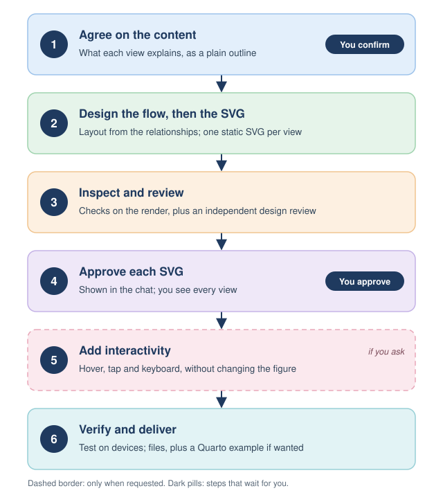

*Written for version 0.1.5.*

The plugin has one skill, `figure-to-interactive`. It takes every figure through six stages, and two of them wait for you. Select the figure to enlarge it.

{.lightbox fig-alt="Six stages from top to bottom. 1, agree on the content of each view; you confirm the outline. 2, design the flow, then draw one static SVG per view. 3, inspect the rendered figure and get an independent design review. 4, approve each SVG; you approve every view before anything is interactive. 5, only if you ask, add hover, tap and keyboard interactivity without changing the approved figure. 6, verify and deliver the files, with a Quarto example when wanted."}

## The stages

1. **Agree on the content.** For a new figure, the assistant asks at most three questions at a time: who the figure is for, which situations it must cover, and how many views it needs. It then writes a plain-language outline of each view: who does what, what is read or saved, the decisions, and the outputs. **You confirm the outline.** Agreeing on tab names is not agreeing on what's in them.
2. **Design the flow, then the SVG.** The layout comes from the relationships: steps in order, equal inputs side by side, exceptions next to the step they affect, and space kept for arrows. Then it draws one static SVG for each view.
3. **Inspect and review.** The assistant checks the rendered picture for clipped or overlapping text, wrong or misleading arrows, and hierarchy. For a substantial figure it asks a separate reviewer for a design review when the app allows that, and says so if it can't.
4. **Approve each SVG.** Each view is shown in the chat. **You approve each one.** Content approval or silence doesn't count, and nothing interactive is built until every view is approved.
5. **Add interactivity, if you ask.** Hover on a desktop, tap on a phone and keyboard access reveal more detail, without changing the approved figure.
6. **Verify and deliver.** The assistant tests what applies, including on real devices where possible, says what it could and couldn't test, and hands over the files, with a Quarto example if you want one.

## Where the rules live

The stages above summarise the skill file, [`SKILL.md`](https://github.com/VagishHemmige/figure-design/blob/main/skills/figure-to-interactive/SKILL.md). It is the authoritative version; the [reference pages](reference/style.qmd) explain the principles and checks it relies on.
